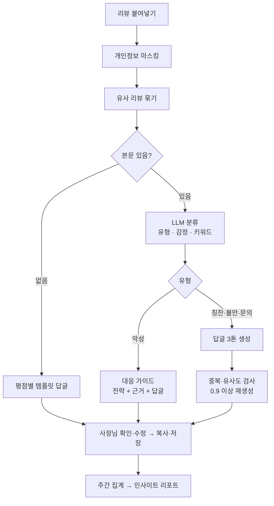
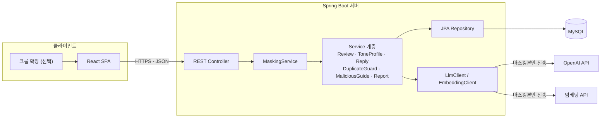
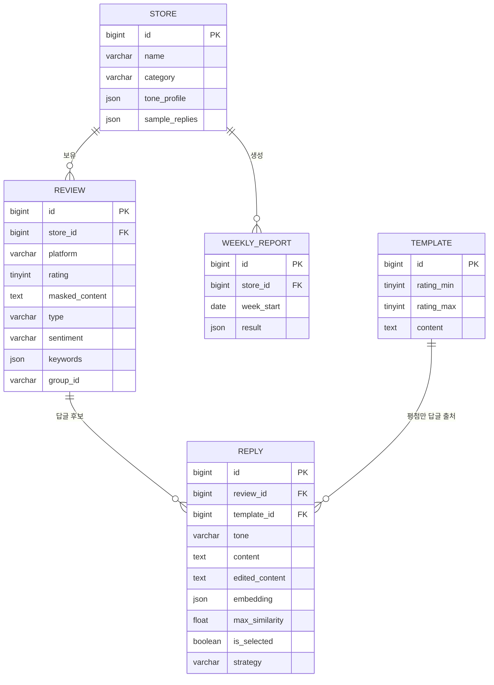

# ReplyBoss — 소상공인 리뷰 답글 매니저

> 배달앱·지도 리뷰를 붙여넣으면 **가게 말투에 맞는 답글 초안**을 만들고, **불만 패턴을 주간 리포트**로 정리해주는 소상공인용 웹 서비스

- **저장소**: https://github.com/Jeong-wooseong/26AI_Project (Public)
- **과목**: 생성형 AI 활용 — 팀/개인 프로젝트
- **개발 기간**: 6주 (2026.10.05 ~ 2026.11.11)
- **상태**: 개발 중 (1·2주차 범위 구현, 아래 [진행 현황](#진행-현황) 참고)

---

## 목차

1. [프로젝트 개요](#1-프로젝트-개요)
2. [문제 정의](#2-문제-정의)
3. [핵심 기능](#3-핵심-기능)
4. [일반 AI와의 차별점](#4-일반-ai와의-차별점)
5. [전체 동작 흐름](#5-전체-동작-흐름)
6. [시스템 아키텍처](#6-시스템-아키텍처)
7. [기술 스택](#7-기술-스택)
8. [데이터베이스 설계](#8-데이터베이스-설계)
9. [API 명세](#9-api-명세)
10. [생성형 AI 활용 방식](#10-생성형-ai-활용-방식)
11. [프로젝트 구조](#11-프로젝트-구조)
12. [실행 방법](#12-실행-방법)
13. [성공 지표](#13-성공-지표)
14. [개발 일정](#14-개발-일정)
15. [원칙 및 한계](#15-원칙-및-한계)

---

## 1. 프로젝트 개요

| 항목 | 내용 |
| --- | --- |
| 서비스명 | ReplyBoss |
| 한 줄 소개 | 리뷰를 붙여넣으면 가게 말투로 답글 초안 3종을 만들고, 불만 패턴을 주간 리포트로 정리 |
| 대상 사용자 | 카페·식당 사장님 (하루 리뷰 5~20개, 별도 마케팅 인력 없음) |
| 활용 상황 | 영업 마감 후 리뷰를 한꺼번에 입력해 답글 초안을 고르고 복사, 주말에 주간 리포트 확인 |
| 개발 목적 | 답글 작성 시간 절감 · 악성 리뷰에 대한 감정적 대응 방지 · 리뷰에서 개선점 도출 |

ReplyBoss는 리뷰를 **직접 게시하지 않습니다.** AI 답글은 모두 초안이며, 사장님이 하나를 골라 확인·수정한 뒤 **작성 완료**로 확정하고, 복사해 각 플랫폼에 올리는 방식입니다. '작성 완료'는 붙여넣을 최종 답글을 확정했다는 뜻이지 외부 플랫폼 게시 완료가 아닙니다.

## 2. 문제 정의

| 사장님의 어려움 | ReplyBoss의 해결 방식 |
| --- | --- |
| 리뷰 답글 작성에 시간이 오래 걸림 | 리뷰 자동 분류 + 답글 초안 3종 자동 생성 |
| 답글이 가게 느낌 없이 기계적임 | 예전 답글에서 가게 말투(톤 프로필)를 추출해 반영 |
| 답글이 매번 비슷하게 반복됨 | 최근 답글과의 유사도를 검사해 반복 표현 차단 |
| 악성 리뷰에 감정적으로 대응하게 됨 | 대응 전략 추천 + 근거 + 차분한 답글 초안 |
| 어떤 불만이 많은지 파악이 어려움 | 불만 주제 순위·전주 대비 변화를 주간 리포트로 제공 |
| 리뷰를 일일이 옮겨 적기 번거로움 | (선택) 크롬 확장으로 리뷰 텍스트 가져오기 |

## 3. 핵심 기능

### 기능 1. 리뷰 입력 및 자동 분류
- 붙여넣은 리뷰의 **개인정보(전화번호·주소 등)를 마스킹**한 뒤 AI에 전달
- LLM이 유형(칭찬 / 불만 / 악성 / 문의), 감정, 키워드(메뉴명·불만 주제)를 **JSON으로 구조화**
- **본문이 없는 평점만 리뷰**는 LLM을 호출하지 않고 규칙으로 처리
- 입력 방식 3가지: **직접 입력**, **여러 리뷰 붙여넣기**(범용 파서로 리뷰 단위 추출), **파일 가져오기**(CSV·XLSX, 열 연결)
  - 일괄 등록은 반드시 미리보기에서 확인·수정·제외 후 등록. 별점을 확정할 수 없으면 비워 두고 사용자가 선택
  - 같은 목록 안 중복, 이미 등록된 리뷰와의 중복(마스킹 후 본문 비교)을 등록 전에 표시
  - 파일은 브라우저 안에서만 읽고 서버에 업로드하지 않음. 플랫폼 공식 리뷰 API 조사 결과는 [docs/review-api-research.md](docs/review-api-research.md)

| 별점 | 평점만 리뷰 처리 |
| --- | --- |
| 4~5점 | 감사 템플릿 풀에서 선택 후 톤 프로필로 가볍게 변형 |
| 3점 | 감사 + 개선 의견 요청 |
| 1~2점 | 사과 + 불편했던 점을 알려달라는 문의형 답글 |
| 공통 | 본문에 없는 내용(맛, 배달 등)을 추측해서 언급하지 않음 |

### 기능 2. 가게 톤 프로필 (자동 추출)
- 사장님이 예전에 쓴 답글 3~5개를 입력하면 LLM이 **존댓말 수준, 이모지 사용, 문장 길이, 자주 쓰는 표현, 마무리 인사**를 추출
- 사장님이 확인·수정 후 저장하면 이후 모든 답글 생성에 반영

### 기능 3. 맞춤형 답글 초안 생성
- **정중형 / 친근형 / 간결형** 3가지 톤의 답글 초안 제공
- 리뷰 키워드를 1개 이상 반드시 반영해 "복사한 듯한" 답글 방지
- 사장님이 입력하지 않은 정보(환불·할인 약속 등)는 사용 금지

### 기능 4. 중복 답글 방지 (3단)
| 단계 | 방식 |
| --- | --- |
| 입력 시 | 비슷한 리뷰끼리 묶어서 처리 |
| 생성 시 | 최근 답글 5~10개를 제시하고 같은 표현을 피하도록 지시 |
| 출력 시 | 임베딩 유사도 0.9 이상이면 자동 재생성 (최대 2회) |

### 기능 5. 악성 리뷰 대응 가이드
- 전략 3종 중 추천: **사과 후 마무리 / 사실 관계 설명 / 응대 보류·신고 검토**
- 추천 근거와 전략에 맞는 답글 초안 제공
- **"사장님 확인 필수"** 표시, 확인 체크 후에만 복사 가능

### 기능 6. 주간 인사이트 리포트
- 불만 주제 순위, 전주 대비 변화, 대표 리뷰 3건, 개선 제안
- 수치는 서버에서 집계하고, AI는 요약·제안 문장만 작성

### (선택) 크롬 확장 리뷰 가져오기
- 리뷰 페이지의 텍스트를 복사해 입력창에 채우는 입력 편의 기능 (자동 게시 없음)
- 일정이 밀리면 제외

## 4. 일반 AI와의 차별점

답글 한 개의 문장 품질보다, **가게의 답글 기록 전체를 관리한다**는 점이 ReplyBoss의 차별점입니다.

| 항목 | 일반 AI에 직접 복사 | ReplyBoss |
| --- | --- | --- |
| 과거 답글 기억 | 지난 답글을 모름 → 표현 반복 | 답글 이력 + 임베딩 유사도로 반복 차단 |
| 누적 분석 | 이번에 붙여넣은 리뷰만 분석 | 주간 불만 순위·전주 대비 변화 제공 |
| 안전 규칙 | 매번 지시해야 하고 없는 약속을 만들기도 함 | 규칙이 시스템에 고정, 출력 후 코드로 재검사 |
| 개인정보 | 사장님이 직접 지워야 함 | 자동 마스킹 후 전송 |
| 일괄 처리 | 여러 리뷰를 넣으면 답글이 섞이고 품질 저하 | 리뷰별 분류·생성, 유형별 정리 |

## 5. 전체 동작 흐름



## 6. 시스템 아키텍처



| 모듈 | 역할 |
| --- | --- |
| MaskingService | 전화번호·이메일·상세 주소·주문번호 마스킹 |
| ReviewService / ClassificationService | 리뷰 저장, 평점만 분기, LLM 분류 및 값 검증 |
| ToneProfileService | 예시 답글로 톤 추출, 사장님 수정본 저장 |
| ReplyService | 3톤 답글 생성, 금지 표현·키워드 반영 검사 |
| DuplicateGuard / EmbeddingService | 유사 리뷰 묶기, 임베딩 유사도 계산, 재생성 |
| MaliciousGuideService | 악성 리뷰 전략·근거·답글 생성 |
| ReportService | 주간 집계(SQL) + LLM 요약·제안 |
| LlmClient | API 호출, 타임아웃, 1회 재요청, JSON 검증 |

## 7. 기술 스택

| 구분 | 기술 |
| --- | --- |
| Frontend | React 18, Vite |
| Backend | Spring Boot 3.5 (Java 17), Spring Data JPA |
| Database | MySQL 8 (설치 없이 실행·테스트할 때는 H2) |
| AI | OpenAI API (Chat Completions 구조화 출력, strict json_schema): 분류·톤 추출 `gpt-6-luna`, 답글 생성 `gpt-6.1-sol` / 임베딩 `text-embedding-3-small` (4주차) |
| 기타 | Chrome Extension (선택), GitHub |

## 8. 데이터베이스 설계



- 리뷰는 **마스킹본만 저장**하고 원문은 저장하지 않습니다.
- 답글 임베딩은 JSON 배열로 저장하고, 최근 답글 5~10개와의 코사인 유사도는 앱에서 계산합니다.
- JSON 성격의 컬럼(키워드, 톤 프로필)은 테스트용 H2 와 호환되도록 TEXT 에 JSON 문자열로 저장합니다.

## 9. API 명세

| 메서드 | 엔드포인트 | 설명 |
| --- | --- | --- |
| POST | `/api/stores` | 가게 등록 |
| POST | `/api/stores/{id}/tone-profile/extract` | 예시 답글로 톤 프로필 추출 |
| PUT | `/api/stores/{id}/tone-profile` | 톤 프로필 수정·저장 |
| POST | `/api/stores/{id}/reviews` | 리뷰 일괄 입력 → 마스킹·분류 결과 |
| GET | `/api/stores/{id}/reviews` | 리뷰·답글 이력 조회 |
| POST | `/api/reviews/{id}/replies` | 답글 3톤 생성 |
| POST | `/api/reviews/{id}/replies/regenerate` | 답글 다시 생성 |
| POST | `/api/reviews/{id}/malicious-guide` | 악성 리뷰 전략·근거·답글 |
| PATCH | `/api/replies/{id}/select` | 선택·수정한 답글 저장 |
| GET | `/api/stores/{id}/reports?week=` | 주간 인사이트 리포트 |

<details>
<summary>요청·응답 예시 (리뷰 일괄 입력)</summary>

```json
// POST /api/stores/1/reviews
{
  "platform": "BAEMIN",
  "reviews": [
    { "rating": 2, "content": "배달이 너무 늦었어요. 010-1234-5678로 연락도 안 되고요" },
    { "rating": 5, "content": "" }
  ]
}

// 200 OK
{
  "results": [
    { "reviewId": 101,
      "maskedContent": "배달이 너무 늦었어요. [전화번호]로 연락도 안 되고요",
      "type": "COMPLAINT", "sentiment": "NEGATIVE",
      "keywords": ["배달 지연", "연락 불가"] },
    { "reviewId": 102, "type": "RATING_ONLY",
      "reply": { "tone": "TEMPLATE", "content": "..." } }
  ]
}
```
</details>

## 10. 생성형 AI 활용 방식

**원칙**: 언어 이해·생성이 필요한 일은 AI가, 정확해야 하는 일(집계·검증·규칙 분기)은 코드가 맡습니다.

| 활용 지점 | AI 기법 | 출력 | 검증 |
| --- | --- | --- | --- |
| 리뷰 분류 | 제로샷 분류 + 키워드 추출 | type, sentiment, keywords | 라벨링 데이터 대비 정확도 |
| 톤 프로필 추출 | 정보 추출 | 말투 특징 JSON | 사장님 확인·수정 |
| 답글 생성 | Few-shot + 제약 조건 생성 | 3톤 답글, 사용 키워드 | 금지 표현·키워드 반영 검사 |
| 중복 방지 | 임베딩 + 회피 지시 | 유사도 점수 | 0.9 이상 재생성 |
| 악성 대응 | 전략 판단 + 근거 설명 | 전략, 근거, 답글 | 사장님 확인 필수 |
| 주간 리포트 | 요약 + 제안 생성 | 요약, 개선 제안 | 수치는 SQL 집계값 사용 |

**품질·안전 관리**
- JSON 스키마 검증 → 실패 시 1회 재요청 → 이후 화면에 재시도 버튼
- 환불·할인·쿠폰 등 금지 표현 사전 검사 후 재생성
- 프롬프트는 `prompts/` 폴더에서 버전 관리하고, 수정할 때마다 같은 평가 셋으로 재측정

## 11. 프로젝트 구조

```
26AI_Project/
├─ backend/                         # Spring Boot 3.5 (Java 17)
│  ├─ src/main/java/com/replyboss/
│  │  ├─ ai/                        # OpenAiLlmClient(구조화 출력), Schemas, PromptTemplates
│  │  ├─ masking/                   # MaskingService (전화번호·이메일·주소·주문번호)
│  │  ├─ store/                     # 가게, 톤 프로필 추출·저장
│  │  ├─ review/                    # 리뷰 입력·분류·재시도, 평가용 분류 API
│  │  ├─ reply/                     # 답글, 평점만 템플릿 풀
│  │  └─ common/                    # 예외 처리, JSON 컬럼 도우미
│  ├─ src/main/resources/prompts/   # 프롬프트 버전 관리 (classify_v1, tone_extract_v1)
│  └─ .env.example
├─ frontend/                        # React 18 + Vite
│  └─ src/pages/                    # StoreSetup, ReviewInput, ReviewList
├─ eval/                            # 라벨링 리뷰 셋, 분류 정확도 측정 스크립트
├─ docker-compose.yml               # 로컬 MySQL
└─ .github/workflows/ci.yml         # 백엔드 빌드·테스트, 프론트 빌드
```

## 12. 실행 방법

필요한 것: JDK 17 이상, Node.js 18 이상, MySQL 8 (또는 Docker), OpenAI API 키

### 1) 저장소 받기

```bash
git clone https://github.com/Jeong-wooseong/26AI_Project.git
cd 26AI_Project
```

### 2) DB 준비

**바로 실행해보려면 (설치 없음)**: 4단계에서 `bootRunLocal` 로 실행하면 MySQL 대신 H2 파일 DB(`backend/data/`)를 쓴다. 이 단계는 건너뛴다.

**MySQL 로 실행하려면** Docker(Windows 는 WSL2 필요)를 쓰거나:

```bash
docker compose up -d
```

MySQL 을 직접 설치했다면 `replyboss` 데이터베이스와 사용자를 만든다 (테이블은 첫 실행 때 자동 생성).

```sql
CREATE DATABASE replyboss DEFAULT CHARACTER SET utf8mb4;
CREATE USER 'replyboss'@'localhost' IDENTIFIED BY 'replyboss';
GRANT ALL ON replyboss.* TO 'replyboss'@'localhost';
```

### 3) 환경 변수

`backend/.env.example` 을 `backend/.env` 로 복사하고 값을 채운다. `.env` 는 저장소에 올리지 않는다.

```
OPENAI_API_KEY=sk-...
DB_URL=jdbc:mysql://localhost:3306/replyboss?serverTimezone=Asia/Seoul&characterEncoding=UTF-8
DB_USERNAME=replyboss
DB_PASSWORD=replyboss
```

### 4) 백엔드 (http://localhost:8080)

```bash
cd backend
./gradlew bootRunLocal   # MySQL 없이 실행 (Windows PowerShell: .\gradlew.bat bootRunLocal)
./gradlew bootRun        # MySQL 로 실행   (Windows PowerShell: .\gradlew.bat bootRun)
./gradlew test           # 테스트 (H2 메모리 DB, LLM 은 가짜로 대체)
```

`bootRunLocal` 로 켰을 때는 http://localhost:8080/h2-console 에서 저장된 데이터를 볼 수 있다 (JDBC URL `jdbc:h2:file:./data/replyboss`, 사용자 `sa`, 비밀번호 없음).

### 5) 프론트엔드 (http://localhost:5173)

```bash
cd frontend
npm install
npm run dev
```

개발 서버가 `/api` 요청을 백엔드(8080)로 넘겨준다.

### 6) 분류 정확도 측정

백엔드를 켠 상태에서 프로젝트 루트에서 실행한다. 자세한 내용은 [eval/README.md](eval/README.md).

```bash
node eval/classify_eval.mjs
```

## 진행 현황

| 주차 | 범위 | 상태 |
| --- | --- | --- |
| 1주차 | 기능 정의, 와이어프레임, ERD, API 명세, 개발 환경, 분류 프롬프트 v1, 라벨링 셋 50개 | 완료 |
| 2주차 | 가게 등록, 톤 프로필 추출·수정·저장, 리뷰 입력, 마스킹, 분류 API, 평점만 분기 + 템플릿 풀, 정확도 측정 스크립트 | 완료 (정확도 1차 측정 필요) |
| 3주차 | 답글 3톤 생성, 톤 주입, 안전 규칙, 편집·복사, 이력 조회 | 진행 중 (3톤 생성·톤 주입·안전 규칙·편집·복사·작성 완료 확정 완료) |

**답글 상태**: 초안(AI 생성, 여러 개) → 작성 완료(사장님이 확정한 최종 답글, 리뷰당 1개, `completedAt` 기록). 복사만으로는 작성 완료가 되지 않습니다. 오늘의 리뷰 기본 목록(작성 완료)에는 최종 답글만 표시하고, 초안 작업은 '작성 대기' 탭에서 합니다. 답글 프롬프트는 `prompts/reply_generate_v3.txt`(매장 소개·감정·최근 최종 답글 반영)를 씁니다.
| 4주차 | 임베딩, 중복 방지 3단, 악성 리뷰 가이드, 예외 처리 | 예정 |
| 5주차 | 주간 리포트, (선택) 크롬 확장, 1차 테스트 | 예정 |

### 현재 동작하는 API

| 메서드 | 엔드포인트 | 설명 |
| --- | --- | --- |
| POST / GET | `/api/stores` | 가게 등록 / 목록 |
| GET / PUT | `/api/stores/{id}` | 가게 조회 / 수정 (매장 소개·운영 방식 `info` 포함) |
| POST | `/api/stores/{id}/tone-profile/extract` | 예시 답글 3~5개로 톤 추출 (저장 안 함) |
| PUT | `/api/stores/{id}/tone-profile` | 톤 프로필 저장 |
| POST | `/api/stores/{id}/reviews` | 리뷰 일괄 입력 → 마스킹·분류 (평점만 리뷰는 템플릿 답글까지) |
| GET | `/api/stores/{id}/reviews?date=&type=` | 날짜·유형별 리뷰 목록 |
| POST | `/api/stores/{id}/reviews/duplicate-check` | 일괄 등록 전 중복 확인 (저장 안 함) |
| POST | `/api/reviews/{id}/replies` | 답글 초안 3종(정중형·친근형·간결형) 생성 / 다시 생성 (최종 답글은 유지) |
| PUT | `/api/reviews/{id}/final-reply` | 작성 완료: 답글 하나를 최종 확정 `{ replyId, content }` (확정한 답글 수정에도 사용) |
| POST | `/api/reviews/{id}/classify` | 분류 다시 시도 |
| PATCH | `/api/replies/{id}/select` | (이전 방식, 화면에서 사용 안 함) 복사한 답글 기록 |
| POST | `/api/eval/classify` | 정확도 측정용 분류 (저장 안 함) |

## 13. 성공 지표

| 지표 | 목표 | 측정 방법 |
| --- | --- | --- |
| 분류 정확도 | 85% 이상 | 라벨링한 리뷰 50개 기준 |
| 답글 중복률 | 50% 이상 감소 | 중복 방지 적용 전후 비교 |
| 답글 작성 시간 | 직접 작성 대비 절반 이하 | 같은 리뷰 묶음으로 시간 비교 |
| 사장님 수정률 | 참고용 | 초안 대비 수정 비율 |

## 14. 개발 일정

| 주차 | 기간 | 단계 | 주요 작업 |
| --- | --- | --- | --- |
| 1주차 | 10/05 ~ 10/09 | 기획·설계 | 기능 정의서, 와이어프레임, ERD, API 명세, 환경 세팅, 샘플 리뷰 50개 라벨링 |
| 2주차 | 10/12 ~ 10/16 | 구현 1 | 가게 등록, 톤 프로필, 리뷰 입력, 마스킹, 분류 API, 평점만 분기 |
| 3주차 | 10/19 ~ 10/23 | 구현 2 | 답글 3톤 생성, 톤 주입, 안전 규칙, 편집·복사, 이력 조회 → **첫 E2E 데모** |
| 4주차 | 10/26 ~ 10/30 | 구현 3 | 임베딩, 중복 방지 3단, 악성 리뷰 가이드, 예외 처리 → **핵심 기능 동결** |
| 5주차 | 11/02 ~ 11/08 | 구현 4 + 테스트 | 주간 리포트, (선택) 크롬 확장, 리뷰 50개 1차 테스트, 개선 → **최종 결과물 완성**(11/06), 지표 측정·README·시연 영상 |
| 6주차 | 11/09 ~ 11/11 | 발표 | 발표 자료 완성(11/09), 리허설(11/10), **최종 발표**(11/11) |

**일정 지연 시 우선순위**: 필수(리뷰 입력·분류, 톤 프로필, 답글 3톤 생성, 복사) → 중요(평점만 분기, 중복 방지, 악성 리뷰 가이드) → 가능하면(주간 리포트) → 선택(크롬 확장)

## 15. 원칙 및 한계

- 모든 답글은 **초안**이며 사람이 확인 후 사용합니다.
- 사장님이 입력하지 않은 정보는 답글에 쓰지 않습니다.
- 개인정보는 마스킹 후 AI에 전송하며, 원문 저장을 최소화합니다.
- 배달앱·지도에 **자동 게시하지 않습니다.**
- LLM 특성상 답글 품질이 매번 같지 않을 수 있으며, 악성 리뷰 대응은 법률 자문을 대신하지 않습니다.
# 26AI_Project
